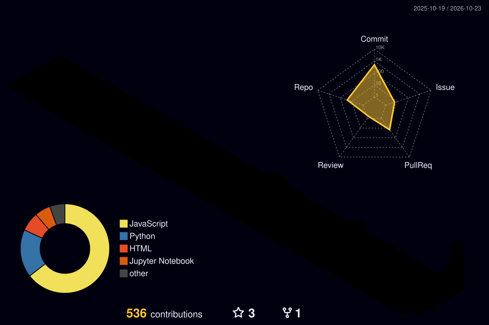

---

## 👋 About Me

I'm Muhammad Farhan, an **AI/ML student, workflow automation builder, and backend web developer** based in Pakistan. I learn by building practical systems across AI, automation, and web development, with a strong interest in applying analytical and statistical thinking to real problems.

- 🤖 Build modular **n8n and LLM-powered automations**, API integrations, and AI-agent workflows.
- 🐍 Develop backend applications with **Python, Django, REST APIs, PostgreSQL, and SQLite**.
- 🧪 Explore applied machine learning, model evaluation, and data-driven research.
- 🔬 Contribute to technical projects and research work as a **Junior Researcher at MRS**.
- 📦 Published a Python package, **illi-ai-professional**, for a local-first AI assistant project.

**Current goal:** grow into an AI and automation engineer by shipping useful, well-documented projects and validating them with repeatable tests.

> *Analyze carefully. Build practically. Validate honestly. Improve continuously.*

## 🎯 Current Focus

| ⚙️ Workflow Automation | 🧠 Applied Machine Learning | 🐍 Backend Engineering |
|:---:|:---:|:---:|
| n8n, LLM orchestration, APIs, Telegram | Data preparation, model evaluation, classification | Python, Django, REST APIs, SQL |

Experience and proficiency vary by technology; projects and learning are ongoing.

## 🚀 Featured Projects

Animated conceptual map of project inputs, processing stages and outputs. It illustrates project ideas and is not a live runtime monitor.

<table>
<tr>
<td width="50%" valign="top">

<h3>🤖 GYRUS — AI Agent</h3>

A Python-based assistant exploring voice and text interaction, desktop workflows, research, and productivity tools.

</td>
<td width="50%" valign="top">

<h3>🖥️ ILLI — AI Assistant</h3>

A Windows-focused Python assistant with a futuristic desktop interface, voice interaction, and system utility workflows.

</td>
</tr>
<tr>
<td width="50%" valign="top">

<h3>🛡️ Phishing URL Detector</h3>

A machine-learning project that identifies potentially phishing URLs using URL-text features. Its repository documents evaluation, testing, and a Streamlit interface.

</td>
<td width="50%" valign="top">

<h3>🔁 FlowForge-AI — n8n Automation Library</h3>

A 20-workflow business automation library covering lead management, customer support, scheduling, content operations, reporting, monitoring, and Telegram. Includes canonical JSON exports, per-workflow setup guides, a shared orchestration architecture, static validation, and a searchable gallery. Provider credentials and live execution must be configured and tested in your own n8n workspace.

</td>
</tr>
<tr>
<td width="50%" valign="top">

<h3>🌌 Galaxy, Star & Quasar Classification</h3>

An applied ML project using SDSS DR16 data. My CV reports **99.19% accuracy** with a Random Forest classifier and identifies redshift as the most predictive feature.

</td>
<td width="50%" valign="top">

<h3>📦 illi-ai-professional</h3>

A published Python package for a local-first AI assistant concept, including a Tkinter GUI, offline speech recognition, and system-automation features.

</td>
</tr>
</table>

## 🧰 Technologies & Learning Areas

 

These represent my current learning and project areas, not a claim of expert-level proficiency in every technology.

## 🐍 Contribution Activity

The animated contribution graphic is generated by GitHub Actions. Its first version appears after the workflow succeeds.

## 🧊 3D Contribution Graph

Generated by the profile's existing GitHub Actions workflow.

## 📊 GitHub Analytics

 

## 💼 Experience Snapshot

- **Junior Researcher — MRS** · May 2026–Present: contribute to research and platform engineering; developed the LMS and supported hosting the company web platform.
- **Machine Learning Intern — LearnDepth Academy LLP** · Aug–Sep 2026: six-week mentor-led programme covering data preparation, supervised/unsupervised learning, model development, and evaluation.
- **Artificial Intelligence Intern — DecodeLabs** · Jul–Aug 2026: worked on end-to-end ML pipelines and statistical model optimization.
- **Backend Developer — MRS** · Jun 2025–Apr 2026: backend and web application work with Python/Django, REST APIs, PostgreSQL, and SQLite.

Experience summaries are based on my CV; project status and implementation details are documented in the linked repositories where available.

## 🧠 Skills

Machine learning and some tools are developing skills; this section reflects the CV and ongoing project work, not expert-level proficiency in every area.

## 🎓 Certifications & Learning

Generative AI Literacy (Simplilearn) · n8n: No Code AI Agent Builder (Simplilearn) · Build Your Own AI Agents on AWS (Skill Nebula) · Agents and Workflows (OpenAI) · AI Foundations (OpenAI) · Claude Code 101 · Claude 101 · Vista Equity Partners AI in Action Job Simulation

## 🤝 Connect

Thanks for visiting — always learning, building, and improving.

